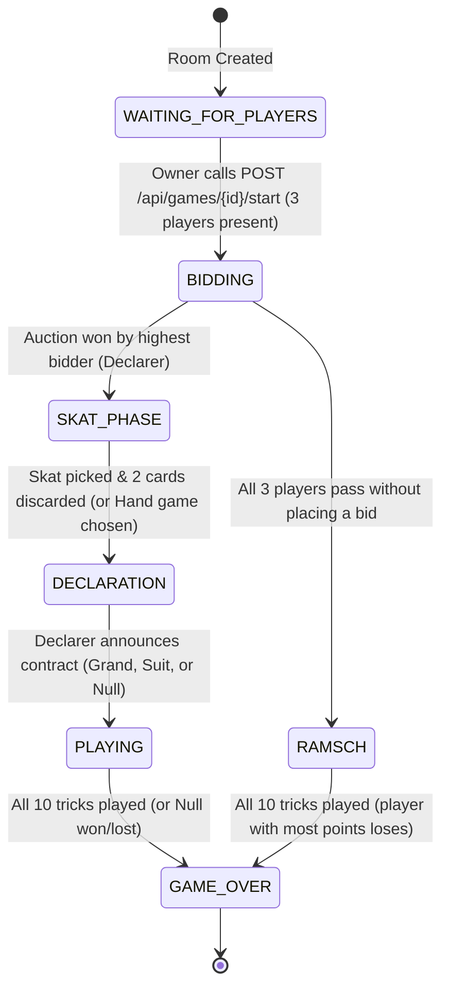

# Skat Backend API & Architecture Documentation

This document describes the expected backend data models, REST endpoints, WebSocket events, and state machine transitions required by the Skat frontend.

---

## 1. Game State Machine

In Skat, games are strictly for **3 active players** (Forehand, Middlehand, Rearhand). Unlike board games, there are no dice rolls or initial board setups.



### State Definitions:
1. **`WAITING_FOR_PLAYERS`**: In lobby, waiting for 3 players to join.
2. **`BIDDING`** *(Reizen)*:
   - Shuffles 32 cards: 10 dealt to each player, 2 into the Skat.
   - Middlehand (*Mittelhand*) calls to Forehand (*Vorhand*) starting at 18.
   - Once one passes, Rearhand (*Hinterhand*) calls to the winner.
   - The last remaining player becomes the **Declarer** (*Alleinspieler*).
   - If all 3 players pass without placing a bid, the game transitions to **`RAMSCH`**.
3. **`SKAT_PHASE`** *(Drücken)*:
   - Declarer chooses to either:
     - **Pick up Skat**: Receives the 2 Skat cards (hand size becomes 12), then discards 2 cards back into the Skat.
     - **Play Hand**: Leaves the Skat face-down without looking (increases game value).
4. **`DECLARATION`** *(Spielansage)*:
   - Declarer announces the game contract: `GRAND`, `CLUBS`, `SPADES`, `HEARTS`, `DIAMONDS`, or `NULL`.
   - Optional announcements: `hand`, `schneider`, `schwarz`, `ouvert`.
5. **`PLAYING`** *(Stichspiel)*:
   - 10 tricks total.
   - Forehand leads the 1st trick. The winner of each trick leads the next.
   - Players must follow suit or trump if possible (*Bedienpflicht*).
6. **`RAMSCH`** *(Alternative when all pass)*:
   - No declarer; every player for themselves.
   - Objective: Take the **fewest** card points (Augen).
   - Forehand leads the 1st trick.
   - The Skat cards remain unlooked-at and their points are added to the winner of the last (10th) trick.
7. **`GAME_OVER`** *(Abrechnung)*:
   - Card points (*Augen*) are counted (total 120; declarer needs ≥ 61 to win; in Ramsch player with most points loses).
   - Game value calculated against the winning bid to verify no overbidding (*Überreizt*).

---

## 2. Data Models (JSON Schemas)

### Card Object
Cards must provide suit and rank:
```json
{
  "type": "Clubs",
  "value": "Jack"
}
```
* **Suits (`type` or `suit`):** `"Clubs"`, `"Spades"`, `"Hearts"`, `"Diamonds"`
* **Values (`value` or `rank`):** `"Seven"`, `"Eight"`, `"Nine"`, `"Ten"`, `"Jack"`, `"Queen"`, `"King"`, `"Ace"`

---

### Player Object
```json
{
  "userId": "user-uuid-123",
  "name": "Alice",
  "playerIndex": 0,
  "points": 0,
  "cardNumber": 10,
  "cards": [
    { "type": "Clubs", "value": "Jack" },
    { "type": "Spades", "value": "Ace" }
  ],
  "currentBid": 18,
  "hasPassed": false,
  "isDeclarer": false
}
```
> **Security Note:** The backend should **only** send the `cards` array of the authenticated player requesting the game state. For opponents, omit `cards` or send an empty array and provide `cardNumber: 10` so clients cannot inspect opponents' hands.

---

### Game Object (`GET /api/games/{id}`)
```json
{
  "id": "game-room-456",
  "state": "BIDDING",
  "ownerId": "user-uuid-123",
  "config": {
    "maxPlayerSize": 3
  },
  "players": {
    "user-uuid-123": { "userId": "user-uuid-123", "name": "Alice", "playerIndex": 0, "cardNumber": 10, "points": 0 },
    "user-uuid-456": { "userId": "user-uuid-456", "name": "Bob", "playerIndex": 1, "cardNumber": 10, "points": 0 },
    "user-uuid-789": { "userId": "user-uuid-789", "name": "Charlie", "playerIndex": 2, "cardNumber": 10, "points": 0 }
  },
  "you": {
    "userId": "user-uuid-123",
    "name": "Alice",
    "playerIndex": 0,
    "cards": [ ...10 card objects... ]
  },
  "currentPlayer": {
    "userId": "user-uuid-456",
    "name": "Bob"
  },
  "currentBid": 18,
  "nextBid": 20,
  "isAnswering": false,
  "gameType": null,
  "skat": [ null, null ],
  "currentTrick": [
    {
      "playerId": "user-uuid-123",
      "playerName": "Alice",
      "card": { "type": "Hearts", "value": "Ten" }
    }
  ]
}
```

---

## 3. REST API Endpoints

All endpoints use `X-User-Id` header (automatically attached via the Axios interceptor).

### Lobby & Lifecycle

| Method | Endpoint | Description |
|---|---|---|
| `GET` | `/api/games` | Returns an array of available game summaries. |
| `POST` | `/api/games/create` | Body: `{ "maxPlayerSize": 3 }`. Returns created game object `{ "id": "..." }`. |
| `POST` | `/api/games/{id}/join?name={name}` | Joins the room. Returns `{ "userId": "..." }`. |
| `POST` | `/api/games/{id}/start` | Owner starts the game. Deals cards, sets state to `BIDDING`. |
| `GET` | `/api/games/{id}` | Returns the full game state customized for the requesting user (`you`). |
| `GET` | `/api/games/info/{id}` | Returns public metadata for lobby preview. |
| `GET` | `/api/games/whoAmI` | Returns string format `"userId;userName"`. |

---

### Skat Gameplay Actions

#### 1. Place Bid
* **`POST /api/games/{id}/bid`**
* **Body:** `{ "bid": 18 }`
* **Backend logic:** 
  * Validates that it is the user's turn to speak (`currentPlayer.userId == request.userId`).
  * If `isAnswering: false` (Caller's turn): Player calls a bid value `bid >= nextBid` matching the Skat bidding table. Updates `currentBid = bid`, sets `isAnswering = true`, and sets `currentPlayer` to the Hearer.
  * If `isAnswering: true` (Hearer's turn): Player holds the bid by submitting `bid: currentBid` ("Ja / Hold"). Updates `nextBid` to the next value in the Skat table, sets `isAnswering = false`, and returns turn to the Caller.

#### 2. Pass / Stop Bidding
* **`POST /api/games/{id}/stopBid`** (or `/passBid`)
* **Backend logic:** 
  * Marks player `hasPassed: true`.
  * If duel 1 (Middlehand vs Forehand) finishes, duel 2 begins with Rearhand calling against the winner.
  * If 2 players have passed, the remaining player becomes Declarer (*Alleinspieler*) and state transitions to `SKAT_PHASE`.
  * If Middlehand and Rearhand pass without bidding, Forehand is prompted: Forehand can bid 18 to play, or pass (`stopBid`). If all 3 pass, the game transitions to `RAMSCH`.

#### 3. Pick Up Skat
* **`POST /api/games/{id}/pickSkat`**
* **Backend logic:** Only callable by the Declarer. Reveals the 2 Skat cards and transfers them to the Declarer's hand (now 12 cards). State remains `SKAT_PHASE` (or `DISCARDING`).

#### 4. Discard Skat Cards ("Drücken")
* **`POST /api/games/{id}/discardSkat`**
* **Body:**
  ```json
  {
    "cards": [
      { "type": "Diamonds", "value": "Seven" },
      { "type": "Hearts", "value": "Eight" }
    ]
  }
  ```
* **Backend logic:** Verifies that exactly 2 cards from the player's 12 cards are submitted. Moves these 2 cards to the player's private Skat (which counts for their end-game points). Transitions state to `DECLARATION`.

#### 5. Declare Game Contract ("Spielansage")
* **`POST /api/games/{id}/declareGame`**
* **Body:**
  ```json
  {
    "gameType": "GRAND",
    "hand": false,
    "schneider": false,
    "schwarz": false,
    "ouvert": false
  }
  ```
* **Options:**
  * `gameType`: `"GRAND"`, `"CLUBS"`, `"SPADES"`, `"HEARTS"`, `"DIAMONDS"`, `"NULL"`
  * `hand`: boolean (true if played without picking up Skat)
  * `schneider`: boolean (announced to win ≥ 90 points)
  * `schwarz`: boolean (announced to win all 10 tricks)
  * `ouvert`: boolean (cards exposed)
* **Backend logic:** Saves contract to `game.gameType`. Sets Forehand (*Vorhand*, playerIndex 0) as `currentPlayer`. Transitions state to `PLAYING`.

#### 6. Play Card
* **`POST /api/games/{id}/playCard`**
* **Body:** `{ "type": "Clubs", "value": "Ace" }`
* **Backend logic:**
  * Checks if it is the player's turn.
  * Validates *Bedienpflicht* (if player has cards of the led suit/trump, they must follow).
  * Appends card to `currentTrick`.
  * If trick now has 3 cards: determines trick winner, awards card points, clears trick after a brief pause, and sets the trick winner as the next `currentPlayer`.
  * If 10 tricks have completed: transitions state to `GAME_OVER` and calculates scores.

---

## 4. WebSocket STOMP Specification

Client connects to `SockJS(VITE_BACKEND_URL + "/ws")`.

### Topics:
* `/topic/games/{gameId}` — Receives all events for a specific room.
* `/topic/gameList` — Receives updates when lobbies are created or states change.

### Message Payloads:
```json
{
  "type": "STARTED_GAME",
  "playerId": "user-uuid-123",
  "message": "Game started",
  "game": { ...updated game state... }
}
```

### Event Types:
* `STARTED_GAME`: Dispatched when lobby transitions to `BIDDING`.
* `START_TURN`: Dispatched when `currentPlayer` changes.
* `BID_PLACED`: Player placed or held a bid.
* `PLAYER_PASSED`: Player passed on bidding.
* `SKAT_PHASE_STARTED`: Auction finished, declarer determined, state transitions to `SKAT_PHASE`.
* `RAMSCH_STARTED`: All 3 players passed without bidding, state transitions to `RAMSCH`.
* `SKAT_PICKED`: Declarer picked up the Skat.
* `SKAT_DISCARDED`: Declarer discarded 2 cards.
* `GAME_DECLARED`: Contract chosen.
* `CARD_PLAYED`: A card was played to the table.
* `TRICK_COMPLETED`: 3 cards played, trick awarded.
* `GAME_OVER`: Game finished, winners and scores calculated.

---

## 5. Skat Rules & Point Values Reference

### Card Points (*Augen*):
* **Ace:** 11 points
* **Ten:** 10 points
* **King:** 4 points
* **Queen:** 3 points
* **Jack:** 2 points
* **7, 8, 9:** 0 points
* **Total in deck:** 120 points (Declarer wins if they collect ≥ 61 points).

### Base Values (*Grundwerte*):
* **Diamonds (Karo):** 9
* **Hearts (Herz):** 10
* **Spades (Pik):** 11
* **Clubs (Kreuz):** 12
* **Grand:** 24
* **Null:** 23 (Hand: 35, Ouvert: 46, Hand Ouvert: 59)

### Bidding Multipliers (*Spitzen / Matadoren*):
Multipliers = (Number of consecutive Jacks held with or without Jack of Clubs) + 1 (Game) [+ 1 Hand] [+ 1 Schneider] [+ 1 Schwarz].
* *Example:* Holding Clubs Jack & Spades Jack, but not Hearts Jack = "With 2, game 3".
* In Clubs game: 3 × 12 = 36 maximum bid.
